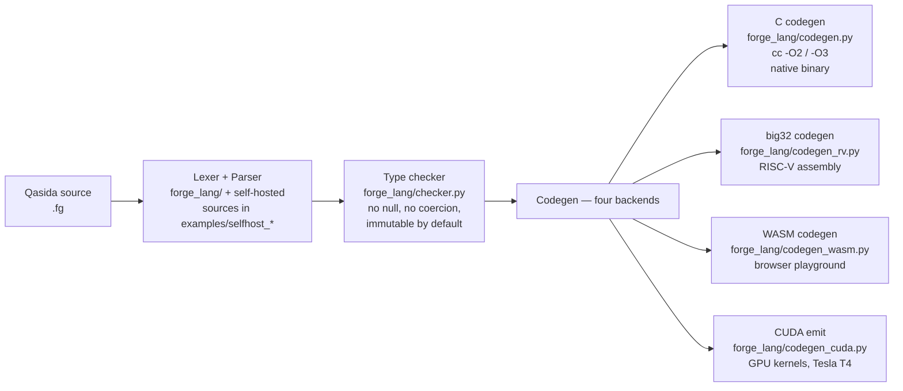
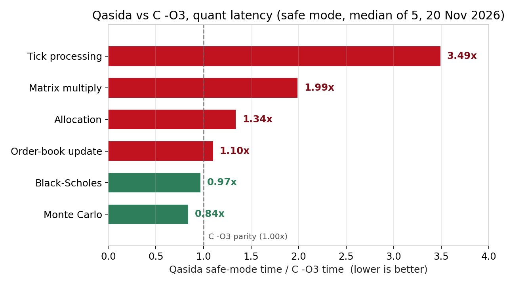
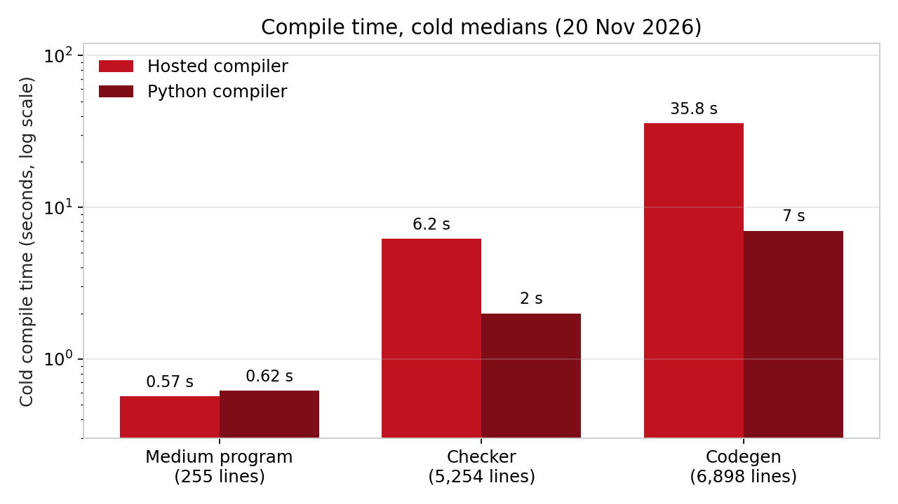
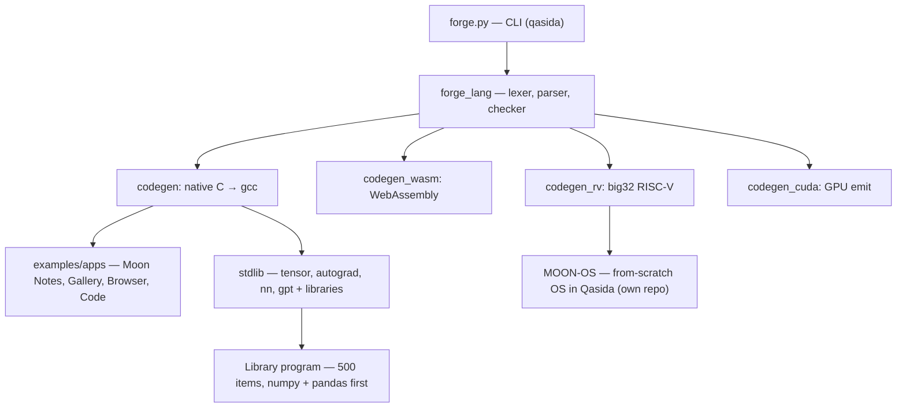

# Qasida

A statically typed language that compiles to native code — and compiles itself.

[](https://github.com/themythofsisyphusjayant/RED-MOON-/releases/tag/v2.3.0)
[](https://pypi.org/project/qasida/)
[](LICENSE)

Qasida is a language for safe, simple, fast tools, CLIs, and small ML programs. It was rebuilt from scratch after a research pass over what people are actually building in 2025–2026 — Zig, Mojo, Carbon, Gleam, Odin, Hare, Roc, Vale — and what developers praise and complain about in Rust, Go, Zig, and Mojo.

The conclusion that drives it: no single language has replaced Rust, Go, or C, and the ones gaining real production use have a narrow beachhead, not a promise to be good at everything. Qasida's beachhead is safe, simple, fast tools — with C-level latency and Python-style ML ease, in one binary.

Technical names (`forge.py`, `forge_lang`, `.fg` files) are unchanged for compatibility, so existing programs keep working.

## The problem

Most languages force a trade at the boundary between tools and ML: write the fast part in a systems language and the model part in Python, then glue them together across a process boundary. The glue is where the bugs, the latency, and the deployment pain live. Qasida's bet is that one language can cover both sides of that boundary — checked arithmetic and real tensors in the same program, compiled to one native binary with no runtime to install.

That bet sets the design, in four rules:

| Rule | What it means in practice |
|---|---|
| Safe by default | Checked integer arithmetic and bounds-checked indexing; a failure aborts with a readable message instead of wrapping or crashing. Fast mode is an explicit opt-in for hot code already validated in safe mode. |
| No null, no coercion | There is no null value and no implicit conversion. Casts are explicit (`x as float`). If a program compiles, its types mean what they say. |
| Immutable by default | Bindings are immutable unless declared `mut`. Function parameters are immutable. Mutation is visible in the source, not hidden in a call. |
| Small to learn, complete to use | One syntax for tools and ML: structs, arrays, and string tools next to tensors, autograd, and a transformer stack — all in the standard library, not an add-on. |

What Qasida is **not**: a Rust or Go replacement, a kernel language, a browser language, or an ML ecosystem rival. Its scope is deliberate — tools, CLIs, servers, and small ML programs — and the roadmap is built outward from that beachhead, not from a feature checklist.

## Status

| Measure | Value |
|---|---|
| Language version | 2.3.0 (16 Nov 2026) |
| Compiler | Self-hosted — the Qasida compiler compiles itself, and is the default since 11 Nov 2026 (Python fallback: `forge.py --python`, or `QASIDA_COMPILER=python`) |
| Install | `pip install qasida` (PyPI, live since 16 Nov 2026) |
| Qasida code in repo | 793 `.fg` files, ~54,000 lines (counted 21 Nov 2026) |
| Standard library | 269 modules in `forge_lang/stdlib/` |
| Registry packages | 30 in `packages/` |
| Library program | 71 complete / 62 partial / 367 to build of 500 (recount, 11 Nov 2026) |
| License | MIT |

## What's new in 2.3.0

Released 16 Nov 2026 — [v2.3.0](https://github.com/themythofsisyphusjayant/RED-MOON-/releases/tag/v2.3.0) · `pip install qasida`

- **Quant latency, complete.** Three fixes, each verified to the full bar (bootstrap 7/7 byte-identical, corpus 99/99, regression 62/62, fuzz 86/86 both modes, parity 96/96, suite PASS both modes): bounds-check hoisting and overflow narrowing, loop-guard placement, and `-march=native` as the safe-mode default, with `--portable` reproducing the old `-O2` behaviour exactly. Measured results are in [Performance](#performance) below.
- **Trig builtins.** `sin`, `cos`, `tan` lower directly to libm, plus a Box–Muller Monte Carlo they unblock. The trig demo is byte-identical to its C reference.
- **40 new standard-library modules**, added 13–16 Nov 2026 and verified under both compilers, including async, channels, datetime, huffman, tarball, unittest, worker pools, bandits, clustering, and lightweight ML framework shims (xgboost-lite, lightgbm-lite, keras-lite, transformers-lite, detection-lite, segmentation-lite, agents-lite, ppo-lite).

## Quickstart

Requirements: Python 3 and a C compiler (`cc` / `gcc`).

```sh
pip install qasida
qasida --version       # Qasida 2.3.0
```

On systems with externally managed Python (Debian/Ubuntu), install into a virtual environment instead:

```sh
python3 -m venv ~/.venv/qasida && source ~/.venv/qasida/bin/activate
pip install qasida
```

From source:

```sh
git clone https://github.com/themythofsisyphusjayant/RED-MOON-
cd RED-MOON-
sh scripts/install.sh   # checks python3 + cc, installs qasida to ~/.local/bin
qasida --version
```

Run your first program — verified live against the PyPI 2.3.0 install, 21 Nov 2026:

```sh
qasida run examples/hello2.fg
```

```
sum = 7.5 len = 3
i = 0 xs[i] = 1.5
i = 1 xs[i] = 2.5
i = 2 xs[i] = 3.5
sqrt(2) = 1.41421 exp(1) = 2.71828
```

More to try:

```sh
qasida run examples/matrix.fg
qasida run examples/ml_linear_regression.fg
qasida run examples/benchmark_scaling.fg
qasida build examples/benchmark.fg -o bench
python3 forge.py test   # full test suite
```

New to programming? Start here, in simple words: [docs/HIGH_SCHOOL_GUIDE.md](docs/HIGH_SCHOOL_GUIDE.md). For a guided tour of the language, see [docs/TOUR.md](docs/TOUR.md).

## Language in 30 seconds

```qasida
import "ml.fg";

fn main() -> int {
    let xs: [float] = [1.0, 2.0, 3.0];
    let mut total: float = 0.0;
    for v in xs {
        total = total + v;
    }
    println("mean =", mean(xs), "total =", total);
    return 0;
}
```

Types: `int` (64-bit), `float` (64-bit), `bool`, `str`, `[T]` arrays, plus user-defined **structs**:

```qasida
struct Point { x: float; y: float; }
let mut q: Point = Point { x: 3.0, y: 4.0 };
q.x = 6.0;
```

Casts are explicit: `x as float`, `y as int`. There is no null and no implicit conversion.

Builtins include `print` / `println`, `push`, `fail`, `assert`, `len`, `range`, `clock_micros`, `sqrt`, `exp`, `log`, `pow`, `abs`, `sin`, `cos`, `tan`, file I/O, string tools, HTTP builtins, and `peek32` / `poke32` / CSR builtins for the freestanding track. Standard library (`forge_lang/stdlib/`, `import "ml.fg"`): `dot`, `mean`, `relu`, `sigmoid`, `matmul`, plus `strings.fg`, `stats.fg`, `tensor.fg`, `autograd.fg`, `nn.fg`, and more.

### Feature map

| Area | What is in the language today |
|---|---|
| Types | `int`, `float`, `bool`, `str`, arrays, structs, explicit casts, no null, no implicit conversion |
| Safety | Checked arithmetic, bounds-checked indexing, immutable-by-default bindings and parameters |
| Control flow | `for` / `while`, `break` / `continue`, `if` / `else`, early `return`, `fail` |
| Functions | First-class enough for the library program; closures and higher-order functions are in progress under the Top-500 roadmap |
| I/O & strings | File I/O, string tools, formatting, regex (`regex.fg`, `regexfull.fg`), CSV, JSON, TOML, XML |
| Concurrency | `async.fg`, `channels.fg`, `workerpool.fg`, `pool.fg`, `taskqueue.fg` |
| Systems | `peek32` / `poke32`, CSR builtins, `ecall`, `trap_handler`, freestanding builds with no host OS |
| ML | Tensors, reverse-mode autograd, transformer blocks, Adam/AdamW, KV-cache inference, int8 quantization |
| Tooling | Package manager, formatter, LSP + VS Code extension, REPL, debugger `#line` info, browser playground |

## Architecture

Qasida compiles in a conventional pipeline — lexer, parser, type checker, C codegen, `cc` — but the compiler itself is written in Qasida. The hosted compiler is the default; the Python implementation remains as a fallback and as the reference for parity checks.



| Stage | Implementation | Notes |
|---|---|---|
| Lexer / parser | `forge_lang/` (Python) + self-hosted Qasida sources in `examples/selfhost_*` | The hosted compiler's lexer, parser, checker, inference, and codegen are Qasida programs |
| Type checker | `forge_lang/checker.py` + hosted checker | No null, no coercion, immutable by default; one-message errors |
| C codegen | `forge_lang/codegen.py` + hosted codegen | Safe mode: checked arithmetic, bounds checks, `-march=native` by default; fast mode: `-O3 -march=native`, unchecked |
| big32 codegen | `forge_lang/codegen_rv.py` | Straight to RISC-V assembly for the big32 CPU — no C in the middle |
| WASM codegen | `forge_lang/codegen_wasm.py` | Powers the browser playground |
| CUDA emit | `forge_lang/codegen_cuda.py` | GPU kernels, verified on a real Tesla T4 |

**Self-hosting, verified.** The hosted compiler bootstraps byte-identically (7/7 bootstrap emits byte-identical at the 2.3.0 bar), and every release fix is verified against the full bar: corpus 99/99, regression 62/62, fuzz 86/86 in both modes, parity 96/96, full suite PASS under both compilers. The two compilers are kept in lockstep — a hosted emit that disagrees with the Python emit is a bug, not a difference of opinion.

**Modes.** Safe mode is the default: checked integer arithmetic and bounds-checked indexing, aborting with a readable message instead of wrapping or crashing. Fast mode (`--mode fast`, `-O3 -march=native`, unchecked) is an explicit opt-in for hot code you have already validated in safe mode. `--portable` reproduces the old `-O2` behaviour exactly.

## Performance

All numbers below are measured, not projected, and the regressions are reported alongside the wins. Full detail: [docs/BENCHMARKS.md](docs/BENCHMARKS.md).

### Quant latency vs C

Safe mode vs C `-O3`, median of 5, re-measured 20 Nov 2026 (Qasida time / C time; lower is better; run dir `blackmoon-iso/quant/run-20261120-24320/`):

| Benchmark | Qasida safe vs C -O3 | Reading |
|---|---:|---|
| Order-book update | 1.10× | Within ~10% of C |
| Tick processing | 3.49× | Still 3.49× slower; cause is a single checked-add site, fix in progress |
| Black–Scholes | 0.97× | Faster than C |
| Monte Carlo | 0.84× | Faster than C |
| Matrix multiply | 1.99× | ~2× off C in safe mode; buffer provenance (push-built arrays), a redesign, not a tuning fix |
| Allocation | 1.34× | Within ~a third of C |



Qasida safe-mode time vs C `-O3`, median of 5, re-measured 20 Nov 2026. Green bars beat C; the dashed line is parity. Tick processing (3.49×) and matrix multiply (1.99×) are the two known safe-mode gaps — the first is a single checked-add site with a fix in progress, the second a buffer-provenance redesign.

In fast mode (`-O3 -march=native`), matrix multiply ties C at ~12.5k µs / 20 reps, and fast mode ties or beats C everywhere else. The 2.3.0 release numbers (order-book 1.03–1.08×, tick 3.71×, Black–Scholes 0.91–0.98×, Monte Carlo 0.92–1.01×, matmul 2.09–2.14×) held on re-measurement within noise, except matmul's 5-run batch, which looked 27% faster until the 9-round interleaved min comparison (1.99× vs 2.0× recorded) showed it was a machine regime, not a compiler gain.

### Compile time

Hosted compiler 2.3.0, cold medians, re-measured 20 Nov 2026:

| Program | Hosted, cold | Python compiler, cold |
|---|---:|---:|
| Medium program (255 lines) | 0.57 s | 0.62 s |
| Checker (5,254 lines) | 6.2 s | 2.0 s |
| Codegen (6,898 lines) | ~35.8 s | 7.0 s |



Cold compile times, medians, 20 Nov 2026 (log scale). The hosted compiler matches Python on a small program but is slower on the two large emits — the codegen case regressed 34% against the 26.6 s recorded at release, and is under investigation.

Warm re-compiles use the emitted-C cache: 0.004 s for the medium program, ~0.2 s for the 6,898-line codegen. Two things to be plain about: the codegen case regressed 34% against the 26.6 s recorded at release, and the Python compiler is currently faster than the hosted binary on the two large emits. Both are under investigation. The 6.77× / 12.28× / 16.42× speedups quoted at the 2.2.0 release (vs 2.1.0) are therefore not quoted here as current — the recorded Python baseline they were measured against (3.8 s / 79.6 s / 437.3 s) is stale; Python has since improved to the numbers above.

### Microsecond latency, measured

A dot product is the unit of ML work. Real Qasida timing (`examples/benchmark_scaling.fg`, safe mode, 100 repetitions each, measured 26 Oct 2026 — your numbers will vary):

| Vector size | Average time per dot |
|------------:|---------------------:|
| 1,000       | 1.03 µs |
| 5,000       | 5.98 µs |
| 10,000      | 10.67 µs |
| 20,000      | 21.59 µs |


Roughly 1 microsecond per 1,000 elements — linear, as it should be for contiguous arrays. Against NumPy and pure Python (26 Oct 2026, `docs/BENCHMARKS.md`): `dot(5000)` at 8 µs vs NumPy 29 µs vs pure Python loops 788 µs; `matmul 64×64` at 615 µs vs NumPy 343 µs (BLAS wins — Qasida's `tensor_matmul` is plain triple loops, and a BLAS-backed matmul is future work, not a claim).

```sh
python3 forge.py run examples/benchmark.fg            # safe mode
python3 forge.py run examples/benchmark.fg --mode fast # -O3 -march=native, unchecked
```

## ML in Qasida

- **Tensors** (`forge_lang/stdlib/tensor.fg`): shape + flat data, matmul, softmax, GELU. **Autograd** (`forge_lang/stdlib/autograd.fg`): a real reverse-mode tape — no hand-written backward code.
- **Transformer blocks** (`forge_lang/stdlib/nn.fg`): Linear, LayerNorm, causal attention, MLP, Adam/AdamW, schedules, clipping, checkpoints, int8 quantization, sampling.
- **Tiny GPT** (`examples/tiny_gpt.fg`): 1 block, 1 head, 776 params, trained by autograd on one sentence — loss 2.274 → 0.360 in ~5 seconds. Generation at this size loops or rambles; the training is the proof.
- **Inference** (`forge_lang/stdlib/inference.fg`): KV-cache steps match a full forward exactly (diff 0). **GPU**: fused attention / LayerNorm / embedding / fp16 kernels in `examples/cuda/`, verified on Kaggle Tesla T4.
- **TinyStories word GPT** (`examples/gpt_tinystories.fg`): real TinyStories data, 12,608 params, held-out perplexity 1078.88 → 385.06 in the single-process run (26 Oct 2026). Sampled output is real words in salad order — not fluent sentences. The tensor version of the same model (100 forward nodes vs 221,844 scalar nodes) trains 1,500 steps in 6.5 s total, 4.35 ms/step, with held-out perplexity 549 → 283.

The loss surface for the linear-regression example (`examples/ml_linear_regression.fg`, data `y = 2x + 1`). Gradient descent walks down this bowl toward the star at `w = 2, b = 1, loss = 0`.


The same run, traced: `w` and `b` converge toward their true values (2 and 1) over 500 gradient-descent iterations, from the real output of `examples/ml_regression_trace.fg` (26 Oct 2026).


Final result after 500 iterations: `w = 2.0211, b = 0.923818`, prediction for `x=6`: `13.0504` — close to the true `w = 2, b = 1, prediction = 13`, not exact, and that honesty matters.

A tiny MLP doing XOR (`examples/ml_mlp_xor.fg`, hand-set sigmoid weights, no Python runtime, no GPU framework):

```
xor 0 0 = 0 (raw 4.54391e-05)
xor 0 1 = 1 (raw 0.999955)
xor 1 0 = 1 (raw 0.999955)
xor 1 1 = 0 (raw 4.54391e-05)
```


```sh
python3 forge.py run examples/tiny_gpt.fg      # trains + generates
python3 forge.py run examples/inference_demo.fg # KV-cache proof
python3 tools/simulate_cuda.py                  # CUDA mirrors
```

## Standard library

269 modules in `forge_lang/stdlib/`, plus 30 registry packages in `packages/`. A sample of the coverage — every module named here exists in the tree:

| Area | Modules |
|---|---|
| ML & numerics | `tensor`, `autograd`, `nn`, `ml`, `numpy`, `pandas`, `sklearn`, `scipy`, `fft`, `quant`, `linearmodels`, `svm`, `clustering`, `decisiontree`, `xgboost`, `lightgbm`, `keras`, `transformers`, `ppo`, `bandits`, `gym`, `rl` |
| Data & formats | `csv`, `json`, `toml`, `xml`, `ini`/`dotenv` config, `markdown`, `mdhtml`, `tarball`, `gzip`, `zlib`, `huffman`, `base64`, `hashlib`, `hmac`, `jwt` |
| Systems & web | `http_server`, `http_client`, `rest`, `webhook`, `regex`, `regexfull`, `sql`, `db`, `fsutils`, `pathlib`, `osinfo`, `spawn`, `tempfile` |
| Concurrency | `async`, `channels`, `workerpool`, `pool`, `taskqueue`, `parallel`, `ratelimit`, `retry-backoff` |
| Everyday | `strings`, `strutils`, `stats`, `statistics`, `datetime`, `dates`, `timezone`, `calendar`, `uuid`, `semver`, `slugify`, `textwrap`, `unittest`, `test`, `log`, `profiler`, `cli`, `cli-table`, `tui`, `plot`, `svg`, `canvas` |
| Geometry & shapes | `vec2`, `vec3`, `triangle`, `rect`, `circle`, `sphere`, `cone`, `cylinder`, `torus`, plus the full polyhedron set |
| Registry packages | `units`, `money`, `geometry`, `interest`, `loans`, `tax`, `statistics`, `matrices`, `vectors`, `primes`, `fractions`, `roman`, `morse`, `cooking`, `budget`, `grades`, `dice`, `colors`, `speed`, `angle`, `bases`, `bmi`, `checks`, `data`, `factors`, `percentages`, `polynomials`, `search`, `sorting`, `textstats` |

The library program behind this is a 500-item roadmap (`docs/LIBRARY_ROADMAP_100.md`, catalog `docs/TOP_500_FEATURES.md`, tracker `docs/TOP_500_PROGRESS.md`) — Mojo / Python / Rust / Go equivalents, built in Qasida itself:

| Status | Count (11 Nov 2026 recount) |
|---|---:|
| Complete (HAVE) | 71 |
| Partial (PARTIAL) | 62 |
| To build (GAP) | 367 |
| **Total** | **500** |

Next in priority: #42, error wrapping with context — currently blocked on a design choice (new syntax vs helper function vs Result method).

## Ecosystem

The full tooling is documented in `docs/ECOSYSTEM.md`:

- **Package manager:** `qasida pkg init/add/build/run/test/list` — vendored dependencies, no registry needed · 30 registry packages in `packages/` (units, money, geometry, interest, …)
- **Formatter:** `qasida fmt <file.fg> [--check]` — idempotent, canonical style
- **Language server:** `qasida lsp` — real-checker diagnostics + completion, with a VS Code extension in `editors/vscode/qasida/` (highlighting, snippets, diagnostics + completion via LSP, Run/Check/Format/Build commands)
- **REPL:** `qasida repl` — keep `let` definitions, evaluate expressions
- **Debugger:** `build --debug` emits `#line` info
- **Playground:** `web/playground.html` — the real compiler under Pyodide, programs run as WebAssembly, no install
- **HTTP server:** `http_listen` / `accept` / `read_request` / `respond` builtins + routing demo, verified live with curl
- **Regex engine:** `forge_lang/stdlib/regex.fg` — literals, `.`, `*` `+` `?`, classes, `\d \w \s`, `^` `$`
- **CI:** `.github/workflows/ci.yml` runs the test suite, formatter check, and ecosystem examples

## Qasida on big32 — the language, running on its own CPU

Qasida has a second backend: instead of C (x86), it can compile straight to RISC-V assembly for **big32**, the 32-bit CPU in the [`BIG-32`](https://github.com/themythofsisyphusjayant/BIG-32) repo. A Qasida program compiled this way runs on big32 in simulation — no x86, no C compiler in the middle.

```sh
python3 forge.py build --target big32 examples/big32/hello.fg -o out/hello
# -> out/hello.s (big32 assembly) + out/hello.hex (for the simulator)
python3 tests/run_big32_tests.py   # model + Verilog, compared with x86
```

Verified programs (`examples/big32/`, each run on x86, in the big32 Python model, and in Icarus Verilog, with identical UART):

| Program | UART output |
|---|---|
| `hello.fg` | `hello from Forge on big32` / `forge + big32` |
| `sum.fg` | `sum = 55` |
| `fib.fg` | `fib = 55` (recursive, the call-spill proof) |
| `muldiv.fg` | `mul = 83810205`, `div = 14 rem = 2`, `neg = -42` |
| `loop_call.fg` | `total = 14`, `len = 5 xs[2] = 4` |
| `forge_os.fg` | Forge OS demo — boots, runs two apps, halts via ECALL |

**Freestanding track:** `--freestanding` builds without any host OS, with raw memory (`peek32`/`poke32`), bitwise operators, CSR builtins, an `ecall` builtin, and a `trap_handler` hook. The full roadmap is `docs/FREESTANDING.md` — the path to a bootable Qasida kernel. The from-scratch OS itself now lives in its own repo: [**MOON-OS**](https://github.com/themythofsisyphusjayant/MOON-OS).

Other backends: **WASM** (`--target wasm`) and **CUDA** emit (`examples/cuda/`, verified on a real Tesla T4).

## Layout

```
forge.py              CLI: check / build / run / emit / fmt / doc / lsp / repl / test,
                      --mode safe|fast, --target native|big32|wasm, --freestanding
forge_lang/           lexer, parser, checker, inference, C codegen, big32 + WASM codegen, driver
                      (plus the self-hosted Qasida compiler — the default since 11 Nov 2026)
forge_lang/stdlib/    269 modules: ml, strings, stats, tensor, autograd, nn, regex, http_server, ...
examples/             362 .fg files: hello2, matrix, benchmark, ML regression, MLP XOR, tiny GPT,
                      big32/, os/, cuda/, trig_demo, selfhost_*
editors/vscode/qasida/   VS Code extension (LSP client, snippets, grammar)
packages/             30 registry packages (units, money, geometry, interest, ...)
docs/                 HIGH_SCHOOL_GUIDE.md (start here) · TOUR.md · ECOSYSTEM.md · FREESTANDING.md
                      STABILITY.md · BENCHMARKS.md · LIBRARY_ROADMAP_100.md · TOP_500_PROGRESS.md
figures/              README figures — benchmark_scaling, loss_3d, xor_heatmap, regression_convergence
                      regenerate via scripts/make_figures.py; benchmarks_quant.png and compile_time.png
                      are from the 20 Nov 2026 re-test (blackmoon-iso/quant/run-20261120-24320/)
tests/                test suite + programs that must fail safely
SPEC_V2.md            the v2 language specification
RESTART.md            why v2 was restarted, and what the research locked in
CHANGELOG.md          what is in each release, and what is honestly not done yet
```

## Project map



## Project status

| Track | State |
|---|---|
| Language 2.3.0 | Released 16 Nov 2026, on PyPI; self-hosted compiler is the default |
| Quant latency (Fixes 1–3) | Complete and verified to the full bar; re-measured 20 Nov, held within noise |
| Compile speed (Steps 2–6) | Done at 2.2.0, but the 20 Nov re-test shows the codegen case regressed 34% and Python now beats hosted on large emits — under investigation, not yet fixed |
| Standard library | 269 modules; 40 added 13–16 Nov; Top-500 at 71/500 complete |
| big32 backend | Verified programs run identically on x86, Python model, and Verilog; freestanding track in progress toward a bootable kernel |
| MOON-OS | Separate repo; OS work continues there, in Qasida |
| VS Code extension | Complete, unpublished (needs a publisher account) |
| Registry | 30 packages live on the public registry (GitHub Pages, read-only static host) — `qasida pkg add-static https://themythofsisyphusjayant.github.io/RED-MOON-/registry-static <name>@<ver>` |

### Known limits

Qasida is production-oriented, not a finished Rust/Go/Mojo rival. The public registry is live at https://themythofsisyphusjayant.github.io/RED-MOON-/registry-static/ (read-only static host; publishing is via git). It still has no fluent text generation, no big32 float division / ordered comparisons / printing / casts, and no PNG/JPEG loading. The playground's end-to-end run in a real browser is not yet verified here. The Step-6 emitted-C cache can serve stale C across compiler rebuilds — clear `/tmp/qasida_cache/` after a rebuild. The compile-speed regression on the largest file, and the Python compiler currently beating the hosted binary on large emits, are open and under investigation. The lifetime-allocator slice has not landed: the kernel builds to 4,319 words but the Python big32 model has 4,096 words of instruction memory. Full details — what is done, what is not, and what is next — live in [CHANGELOG.md](CHANGELOG.md) and `SPEC_V2.md`, not hidden.

## Links

- **PyPI:** [pypi.org/project/qasida](https://pypi.org/project/qasida/) — `pip install qasida`
- **Releases:** [github.com/themythofsisyphusjayant/RED-MOON-/releases](https://github.com/themythofsisyphusjayant/RED-MOON-/releases) — latest: [v2.3.0](https://github.com/themythofsisyphusjayant/RED-MOON-/releases/tag/v2.3.0)
- **Changelog:** [CHANGELOG.md](CHANGELOG.md)
- **Docs:** [docs/HIGH_SCHOOL_GUIDE.md](docs/HIGH_SCHOOL_GUIDE.md) (start here) · [docs/TOUR.md](docs/TOUR.md) · [docs/ECOSYSTEM.md](docs/ECOSYSTEM.md) · [docs/FREESTANDING.md](docs/FREESTANDING.md) · [docs/STABILITY.md](docs/STABILITY.md) · [docs/BENCHMARKS.md](docs/BENCHMARKS.md)
- **OS track:** [MOON-OS](https://github.com/themythofsisyphusjayant/MOON-OS) · **CPU track:** [BIG-32](https://github.com/themythofsisyphusjayant/BIG-32)
