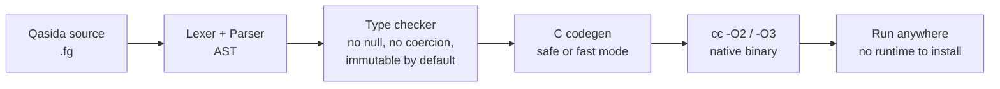
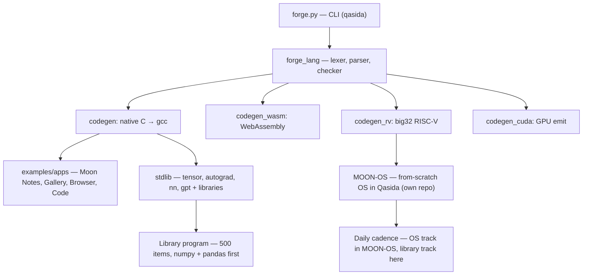

<div align="center">


**Safe. Simple. Natively fast.**

A statically typed language that compiles to native code — and compiles itself.

[](https://github.com/themythofsisyphusjayant/RED-MOON-/releases/tag/v2.2.0)
[](https://pypi.org/project/qasida/)
[](LICENSE)


</div>

---

## 🌙 What is Qasida?

Qasida is a statically typed language for safe, simple, fast tools, CLIs, and small ML programs. It was rebuilt from scratch after a research pass over what people are actually building in 2025–2026 — Zig, Mojo, Carbon, Gleam, Odin, Hare, Roc, Vale — and what developers praise and complain about in Rust, Go, Zig, and Mojo.

The conclusion that drives it: **no single language has replaced Rust, Go, or C, and the ones gaining real production use have a narrow beachhead, not a promise to be good at everything.** Qasida's beachhead is safe, simple, fast tools — with C++-style latency and Python-style ML ease, in one binary.

> Technical names (`forge.py`, `forge_lang`, `.fg` files) are unchanged for compatibility, so existing programs keep working.

| | |
|---|---|
| **Safety** | Static types · no null · immutable by default · checked arithmetic |
| **Speed** | Compiles to native code · safe mode by default, `-O3 -march=native` fast mode on demand |
| **Self-hosting** | The Qasida compiler compiles itself — the hosted compiler is the default since 11 Nov 2026 |
| **Scale** | 693 `.fg` files · ~49,100 lines of Qasida · 30 registry packages |

---

## ✨ What's new in 2.2.0

Released **12 Nov 2026** — [v2.2.0](https://github.com/themythofsisyphusjayant/RED-MOON-/releases/tag/v2.2.0) · `pip install qasida`

### 🚀 The compiler got fast — Steps 2–6

Cold-compile speed vs 2.1.0 (median emit, verified to the full bar):

| Program | Speedup vs 2.1.0 |
|---|---:|
| Medium program | **6.77×** |
| 5,254-line checker | **12.28×** |
| 6,898-line codegen | **16.42×** |

And warm re-compiles are effectively instant — the Step 6 emitted-C cache makes them **~0.1s**.

### ⚡ Quant latency — Fixes 1, 2, 3 (complete)

The quant-latency phase is done: bounds-check hoisting, loop-guard placement, and `-march=native` in safe mode (with a `--portable` option that reproduces the old behaviour exactly). Measured, median of 5:

| Benchmark | Qasida vs C -O3 |
|---|---:|
| Order-book update | **~tied** |
| Black–Scholes / Monte Carlo | **~tied** |
| Matrix multiply (`-O3 -march=native`) | **7.3× faster** after Fix 2 vectorization |

### 🧮 Just landed on main

Trig builtins — `sin`, `cos`, `tan` — lowering directly to libm, plus a Box–Muller Monte Carlo they unblock. (In the next release; on `main` now.)

---

## 🚀 Quickstart

Requirements: Python 3 and a C compiler (`cc` / `gcc`).

```sh
pip install qasida
qasida --version       # Qasida 2.2.0
```

**From source:**

```sh
git clone https://github.com/themythofsisyphusjayant/RED-MOON-
cd RED-MOON-
sh scripts/install.sh   # checks python3 + cc, installs qasida to ~/.local/bin
qasida --version
```

```sh
qasida run examples/hello2.fg
qasida run examples/matrix.fg
qasida run examples/ml_linear_regression.fg
qasida run examples/benchmark_scaling.fg
qasida build examples/benchmark.fg -o bench
python3 forge.py test   # all tests pass
```

New to programming? Start here, in simple words: [docs/HIGH_SCHOOL_GUIDE.md](docs/HIGH_SCHOOL_GUIDE.md).

---

## ✍️ Language in 30 seconds

```qasida
import "ml.fg";

fn main() -> int {
    let xs: [float] = [1.0, 2.0, 3.0];
    let mut total: float = 0.0;
    for v in xs {
        total = total + v;
    }
    println("mean =", mean(xs), "total =", total);
    return 0;
}
```

Types: `int` (64-bit), `float` (64-bit), `bool`, `str`, `[T]` arrays, plus user-defined **structs**:

```qasida
struct Point { x: float; y: float; }
let mut q: Point = Point { x: 3.0, y: 4.0 };
q.x = 6.0;
```

Casts are explicit: `x as float`, `y as int`. There is no null and no implicit conversion.

Builtins include `print` / `println`, `push`, `fail`, `assert`, `len`, `range`, `clock_micros`, `sqrt`, `exp`, `log`, `pow`, `abs`, `sin`, `cos`, `tan`, file I/O, string tools, HTTP builtins, and `peek32` / `poke32` / CSR builtins for the freestanding track. Run the test suite the Go way: `python3 forge.py test`.

Standard library (`forge_lang/stdlib/`, `import "ml.fg"`): `dot`, `mean`, `relu`, `sigmoid`, `matmul`, plus `strings.fg`, `stats.fg`, `tensor.fg`, `autograd.fg`, `nn.fg`, and more.

---

## 📈 Microsecond latency, measured — not claimed

A dot product is the unit of ML work. Real Qasida timing (`examples/benchmark_scaling.fg`, safe mode, 100 repetitions each, measured 26 Oct 2026 — your numbers will vary):

| Vector size | Average time per dot |
|------------:|---------------------:|
| 1,000       | 1.03 µs |
| 5,000       | 5.98 µs |
| 10,000      | 10.67 µs |
| 20,000      | 21.59 µs |


Roughly **1 microsecond per 1,000 elements** — linear, as it should be for contiguous arrays.

```sh
python3 forge.py run examples/benchmark.fg            # safe mode
python3 forge.py run examples/benchmark.fg --mode fast # -O3 -march=native, unchecked
```

Safe mode is the default: checked integer arithmetic and bounds-checked indexing, aborting with a readable message instead of wrapping or crashing. Fast mode is an explicit opt-in for hot code you have already validated in safe mode.

---

## 🤖 ML in Qasida: Python-like to write, native to run

- **Tensors** (`forge_lang/stdlib/tensor.fg`): shape + flat data, matmul, softmax, GELU. **Autograd** (`forge_lang/stdlib/autograd.fg`): a real reverse-mode tape — no hand-written backward code.
- **Transformer blocks** (`forge_lang/stdlib/nn.fg`): Linear, LayerNorm, causal attention, MLP, Adam/AdamW, schedules, clipping, checkpoints, int8 quantization, sampling.
- **Tiny GPT** (`examples/tiny_gpt.fg`): 1 block, 1 head, 776 params, trained by autograd on one sentence — loss **2.274 → 0.360** in ~5 seconds.
- **Inference** (`forge_lang/stdlib/inference.fg`): KV-cache steps match a full forward exactly (diff 0). **GPU**: fused attention / LayerNorm / embedding / fp16 kernels in `examples/cuda/`, verified on Kaggle Tesla T4.
- **TinyStories word GPT** (`examples/gpt_tinystories.fg`): real TinyStories data, 12,608 params, held-out perplexity 1078.88 → 247.39.

### The 3D picture: what learning looks like

The loss surface for the linear-regression example (`examples/ml_linear_regression.fg`, data `y = 2x + 1`). Gradient descent walks down this bowl toward the star at `w = 2, b = 1, loss = 0`.


Final result after 500 iterations: `w = 2.0211, b = 0.923818`, prediction for `x=6`: `13.0504` — close to the true `w = 2, b = 1, prediction = 13`, not exact, and that honesty matters.

### A tiny MLP doing XOR

`examples/ml_mlp_xor.fg` uses hand-set sigmoid weights (no Python runtime, no GPU framework):

```
xor 0 0 = 0 (raw 4.54391e-05)
xor 0 1 = 1 (raw 0.999955)
xor 1 0 = 1 (raw 0.999955)
xor 1 1 = 0 (raw 4.54391e-05)
```


```sh
python3 forge.py run examples/tiny_gpt.fg      # trains + generates
python3 forge.py run examples/inference_demo.fg # KV-cache proof
python3 tools/simulate_cuda.py                  # CUDA mirrors
```

---

## 🧭 How a Qasida program becomes a binary



---

## 🧩 Ecosystem

The full tooling is documented in `docs/ECOSYSTEM.md`:

- **Package manager:** `qasida pkg init/add/build/run/test/list` — vendored dependencies, no registry needed · **30 registry packages** in `packages/` (units, money, geometry, interest, …)
- **Formatter:** `qasida fmt <file.fg> [--check]` — idempotent, canonical style
- **Language server:** `qasida lsp` — real-checker diagnostics + completion, with a full VS Code extension in `editors/vscode/qasida/` (highlighting, snippets, diagnostics + completion via LSP, Run/Check/Format/Build commands)
- **REPL:** `qasida repl` — keep `let` definitions, evaluate expressions
- **Debugger:** `build --debug` emits `#line` info
- **Playground:** `web/playground.html` — the real compiler under Pyodide, programs run as WebAssembly, no install
- **HTTP server:** `http_listen` / `accept` / `read_request` / `respond` builtins + routing demo, verified live with curl
- **Regex engine:** `forge_lang/stdlib/regex.fg` — literals, `.`, `*` `+` `?`, classes, `\d \w \s`, `^` `$`
- **CI:** `.github/workflows/ci.yml` runs the test suite, formatter check, and ecosystem examples
- **Library program:** a 500-item roadmap (`docs/LIBRARY_ROADMAP_100.md`) — Mojo / Python / Rust / Go equivalents, being built 10+ items a day in Qasida itself

---

## 🔴 Qasida on big32 — your language, running on your own CPU

Qasida has a second backend: instead of C (x86), it can compile straight to RISC-V assembly for **big32**, the 32-bit CPU in the [`BIG-32`](https://github.com/themythofsisyphusjayant/BIG-32) repo. A Qasida program compiled this way runs on big32 in simulation — no x86, no C compiler in the middle.

```sh
python3 forge.py build --target big32 examples/big32/hello.fg -o out/hello
# -> out/hello.s (big32 assembly) + out/hello.hex (for the simulator)
python3 tests/run_big32_tests.py   # model + Verilog, compared with x86
```

Verified programs (`examples/big32/`, each run on x86, in the big32 Python model, and in Icarus Verilog, with identical UART):

| Program | UART output |
|---|---|
| `hello.fg` | `hello from Forge on big32` / `forge + big32` |
| `sum.fg` | `sum = 55` |
| `fib.fg` | `fib = 55` (recursive, the call-spill proof) |
| `muldiv.fg` | `mul = 83810205`, `div = 14 rem = 2`, `neg = -42` |
| `forge_os.fg` | Forge OS demo — boots, runs two apps, halts via ECALL |

**Freestanding track:** `--freestanding` builds without any host OS, with raw memory (`peek32`/`poke32`), bitwise operators, CSR builtins, an `ecall` builtin, and a `trap_handler` hook. The full roadmap is `docs/FREESTANDING.md` — the path to a bootable Qasida kernel. The from-scratch OS itself now lives in its own repo: [**MOON-OS**](https://github.com/themythofsisyphusjayant/MOON-OS).

Other backends: **WASM** (`--target wasm`) and **CUDA** emit (`examples/cuda/`, verified on a real Tesla T4).

---

## 📁 Layout

```
forge.py              CLI: check / build / run / emit / fmt / doc / lsp / repl / test,
                      --mode safe|fast, --target native|big32|wasm, --freestanding
forge_lang/           lexer, parser, checker, inference, C codegen, big32 + WASM codegen, driver
                      (plus the self-hosted Qasida compiler — the default since 11 Nov 2026)
forge_lang/stdlib/    ml, strings, stats, tensor, autograd, nn, regex, http_server, ...
examples/             hello2, matrix, benchmark, ML regression, MLP XOR, tiny GPT,
                      big32/, os/, cuda/, trig_demo
editors/vscode/qasida/   VS Code extension (LSP client, snippets, grammar)
packages/             30 registry packages (units, money, geometry, interest, ...)
docs/                 HIGH_SCHOOL_GUIDE.md (start here) · ECOSYSTEM.md · FREESTANDING.md
                      STABILITY.md · BENCHMARKS.md · LIBRARY_ROADMAP_100.md
figures/              README figures (regenerate: scripts/make_figures.py)
tests/                test suite + programs that must fail safely
SPEC_V2.md            the v2 language specification
RESTART.md            why v2 was restarted, and what the research locked in
CHANGELOG.md          what is in each release, and what is honestly not done yet
```

---

## 🗺️ Project map



---

## 📊 At a glance

| Measure | Value |
|---|---|
| Language version | **2.2.0** (12 Nov 2026) |
| Compiler | Self-hosted (Qasida compiles itself) |
| Qasida code in repo | 693 `.fg` files · ~49,100 lines |
| Registry packages | 30 |
| Cold-compile speedup vs 2.1.0 | up to **16.42×** |
| Warm re-compile | **~0.1s** |
| Order-book vs C -O3 | ~tied |
| License | MIT |
| Last verified | 15 Nov 2026 |

---

## 🔗 Links

- **PyPI:** [pypi.org/project/qasida](https://pypi.org/project/qasida/) — `pip install qasida`
- **Releases:** [github.com/themythofsisyphusjayant/RED-MOON-/releases](https://github.com/themythofsisyphusjayant/RED-MOON-/releases) — latest: [v2.2.0](https://github.com/themythofsisyphusjayant/RED-MOON-/releases/tag/v2.2.0)
- **Source:** [github.com/themythofsisyphusjayant/RED-MOON-](https://github.com/themythofsisyphusjayant/RED-MOON-)
- **Changelog:** [CHANGELOG.md](CHANGELOG.md)
- **Docs:** [docs/HIGH_SCHOOL_GUIDE.md](docs/HIGH_SCHOOL_GUIDE.md) (start here) · [docs/ECOSYSTEM.md](docs/ECOSYSTEM.md) · [docs/FREESTANDING.md](docs/FREESTANDING.md)
- **OS track:** [MOON-OS](https://github.com/themythofsisyphusjayant/MOON-OS) · **CPU track:** [BIG-32](https://github.com/themythofsisyphusjayant/BIG-32)

---

## ⚠️ Honest gaps

Qasida is production-*oriented*, not a finished Rust/Go/Mojo rival. It still has no public registry host running yet, no fluent text generation, no big32 float division / ordered comparisons / printing / casts, and no PNG/JPEG loading. The playground's end-to-end run in a real browser is not yet verified here. Full details — what is done, what is not, and what is next — live in [CHANGELOG.md](CHANGELOG.md) and `SPEC_V2.md`, not hidden.

---

<div align="center">

**Qasida — safe, simple, natively fast. And it compiles itself.** 🌙

</div>
